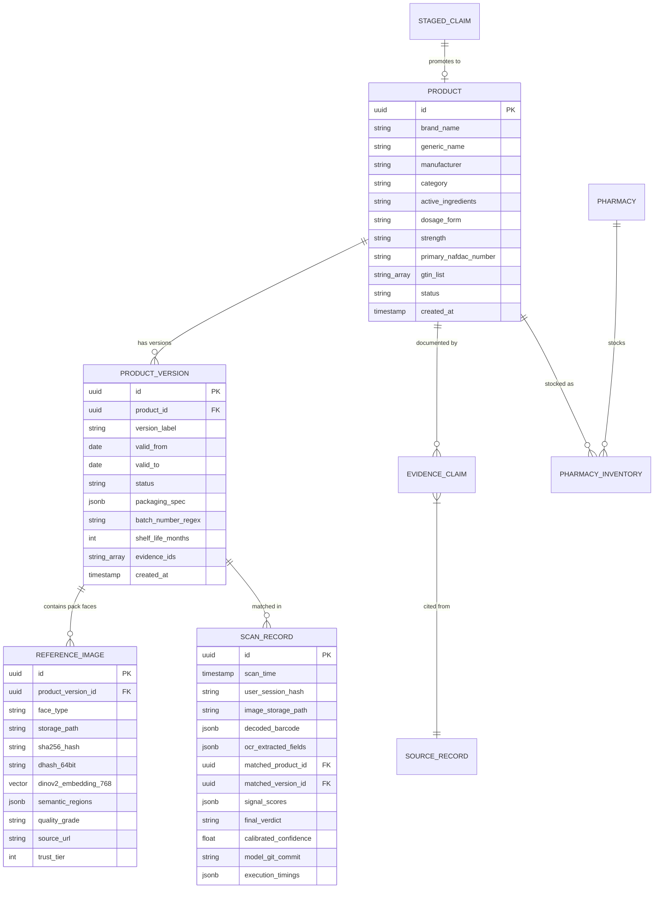
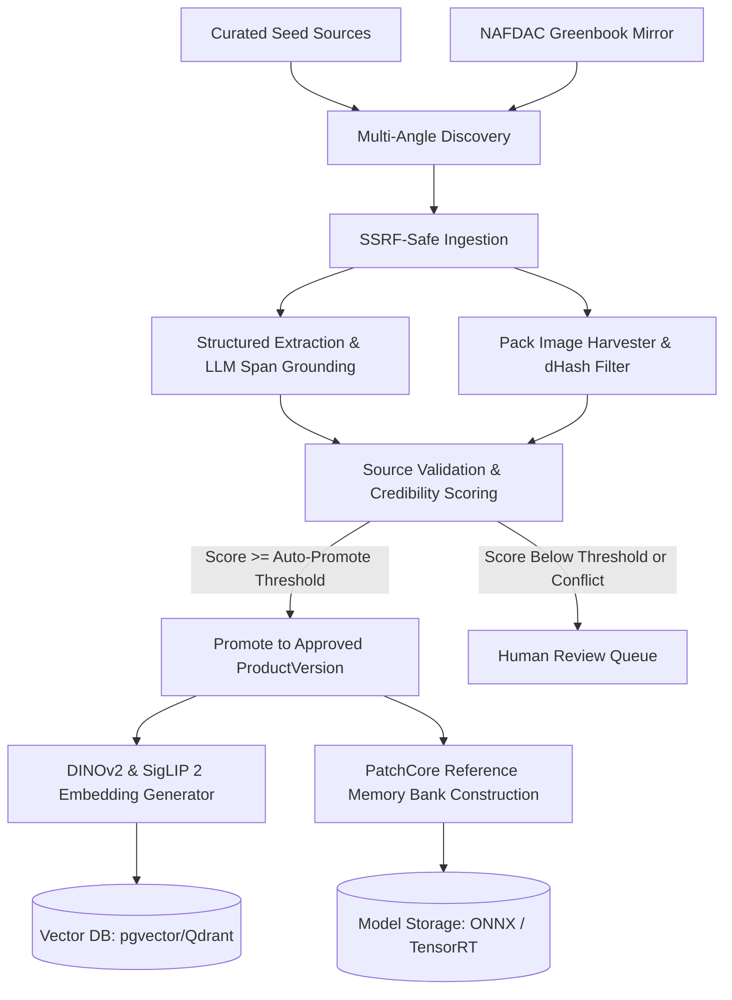
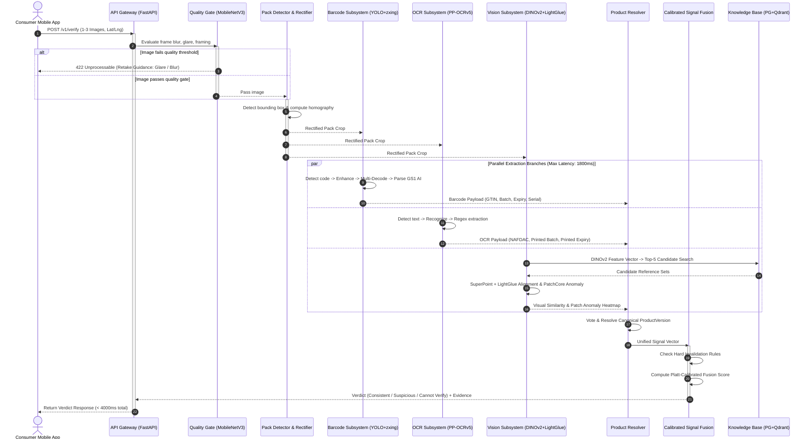
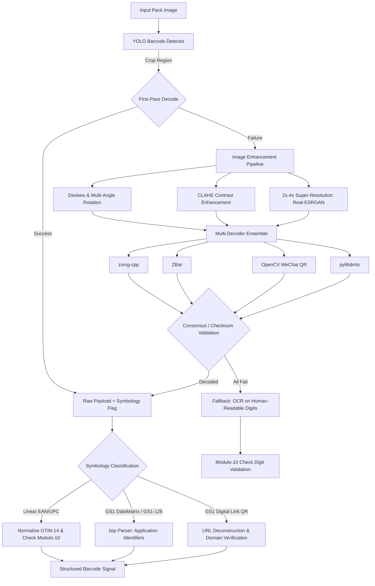
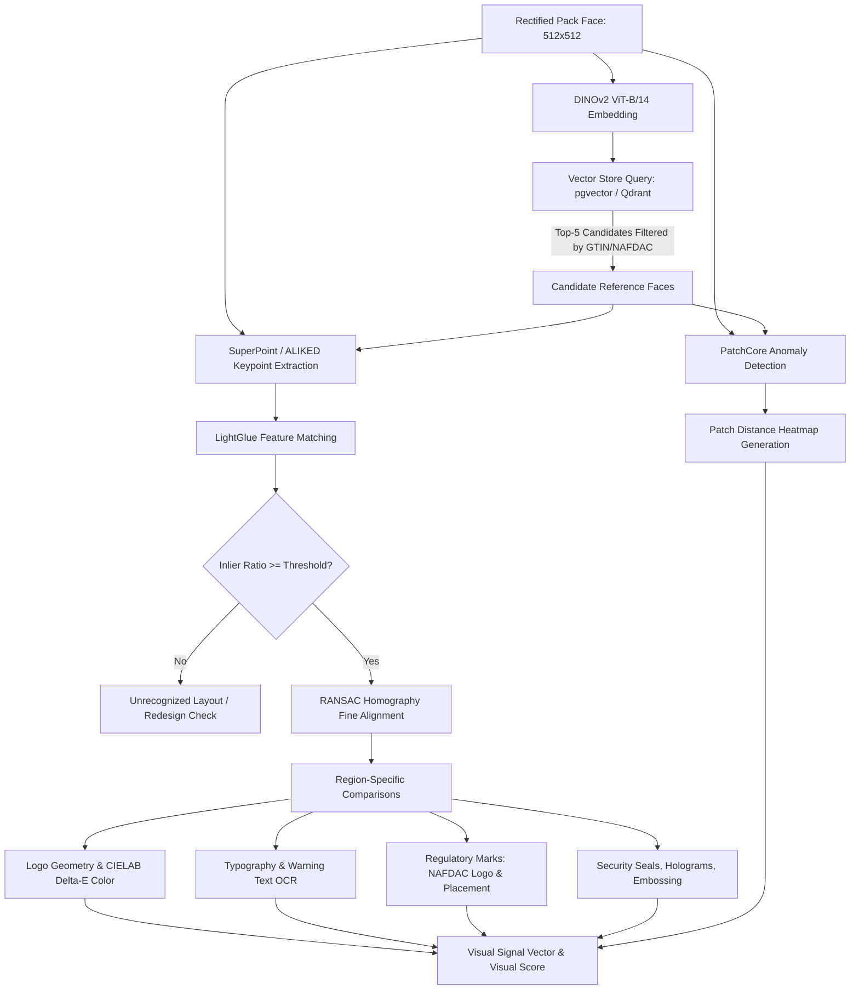
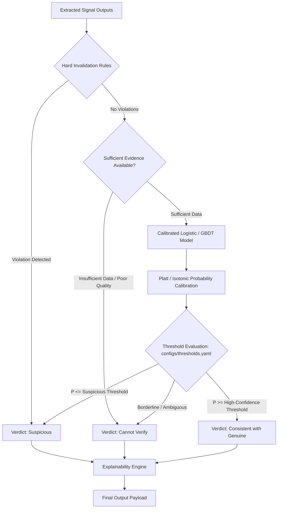
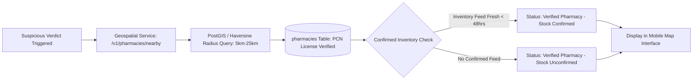
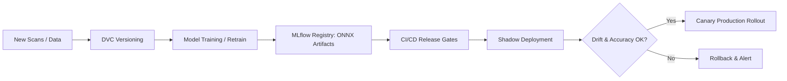
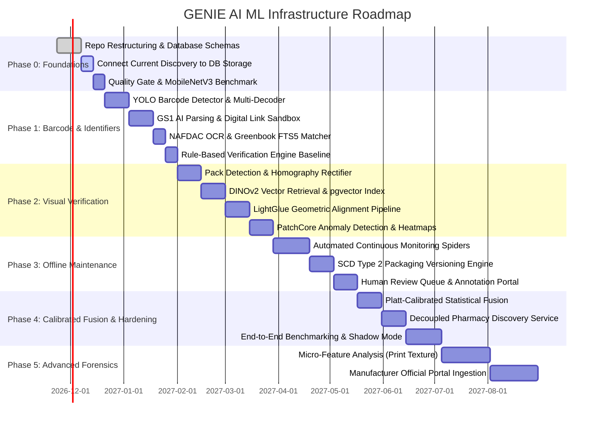

# GENIE AI — Machine Learning & Computer Vision Infrastructure Build Plan
**Comprehensive Engineering Design & Implementation Roadmap for the Core Product Intelligence & Verification Layer**

---

## 1. Executive Summary & Architectural Mission

**GENIE AI** serves as the intelligence, verification, and computer vision backbone powering **Genium**—an anti-counterfeiting platform designed to safeguard consumers against counterfeit pharmaceuticals, food products, and fast-moving consumable goods (FMCG), starting with pharmaceuticals in Nigeria.

The platform executes two primary operational mandates:
1. **Offline / Background Plane (Learn, Validate & Maintain):** Continuously discovers, extracts, validates, versions, and indexes authoritative reference data and visual packaging signatures from trusted manufacturer, regulatory (NAFDAC), and clinical sources.
2. **Online Verification Plane (Real-Time Scan & Explainable Verdict):** Ingests consumer phone scans, enforces image quality gating, executes parallel barcode, OCR, and computer vision feature extraction, matches against version-bounded product references, and fuses independent signals into a calibrated, explainable three-state verdict within a **< 4-second latency budget**.

```
                           +------------------------------------------+
                           |       PRODUCT INTELLIGENCE DATABASE      |
                           |  - PostgreSQL 16 (Relational & Audit)    |
                           |  - pgvector / Qdrant (Visual Embeddings) |
                           |  - S3 / R2 Object Storage (Images)       |
                           +--------------------+---------------------+
                                                ^
                     OFFLINE PLANE              |              ONLINE PLANE
            +-------------------------------+   |   +--------------------------------+
            | 1. Discovery & Web Ingestion  |   |   | 1. Mobile Scan Ingestion       |
            |    (Current Repo Discovery)   |   |   |    (Genium API Gateway)        |
            | 2. Structured Extraction      +---+   +---------------+----------------+
            |    (NAFDAC Greenbook + LLM)   |                       |
            | 3. Source & Evidence Gate     |       +---------------v----------------+
            | 4. Pack Image Curation (dHash)|       | 2. Fast Quality Gate (<150ms)  |
            | 5. Versioning & SCD Tracking  |       +---------------+----------------+
            | 6. Visual Vector Indexing     |                       |
            | 7. Model Training & Fine-Tune |       +---------------v----------------+
            +-------------------------------+       | 3. Pack Detect & Rectification |
                                                    +---------------+----------------+
                                                                    |
                                        +---------------------------+---------------------------+
                                        |                           |                           |
                            +-----------v-----------+   +-----------v-----------+   +-----------v-----------+
                            | 4. Barcode Subsystem  |   | 5. OCR & Key-Field    |   | 6. Computer Vision    |
                            |    - YOLO Detect      |   |    - Text Detection   |   |    - DINOv2 Retrieval |
                            |    - Super-Resolution |   |    - PP-OCRv5 / docTR |   |    - LightGlue Align  |
                            |    - Multi-Decoder    |   |    - NAFDAC / Batch   |   |    - Region Check     |
                            |    - GS1 AI Parser    |   |      Regex & Match    |   |    - PatchCore Anomaly|
                            +-----------+-----------+   +-----------+-----------+   +-----------+-----------+
                                        |                           |                           |
                                        +---------------------------+---------------------------+
                                                                    |
                                                    +---------------v----------------+
                                                    | 7. Product Resolution (Voting) |
                                                    +---------------+----------------+
                                                                    |
                                                    +---------------v----------------+
                                                    | 8. Calibrated Signal Fusion    |
                                                    |    - Hard Invalidation Rules   |
                                                    |    - Platt-Calibrated Logistic |
                                                    +---------------+----------------+
                                                                    |
                                                    +---------------v----------------+
                                                    | 9. Explainability & Output     |
                                                    |    - 3-State Verdict           |
                                                    |    - Evidence Links & Heatmaps |
                                                    |    - Decoupled Pharmacy Router |
                                                    +--------------------------------+
```

### Bridging Current Repository Work to the Full ML Vision
The existing repository has already established the foundation of the **Offline Plane**:
- **Web Acquisition & Scraping (`scraper/`):** Forked, hardened search engine integrations (`duckduckgo.py`, `searxng.py`, `cloud.py`), SSRF-safe page fetching (`pages.py`, `egress.py`), PDF extraction (`pdf.py`), and JSON-LD schema parsing (`structured.py`) capturing `schema.org/Product` and `schema.org/Drug`.
- **Regulatory Mirror (`registry/greenbook.py`):** High-speed local SQLite + FTS5 mirror of the NAFDAC Greenbook (~9,000+ Nigerian registered pharmaceutical records) enabling sub-millisecond offline lookup by registration number, brand, manufacturer, and active ingredients.
- **Multi-Angle Discovery (`discovery/`):** Orchestrator (`planner.py`, `runner.py`) executing 5 targeted search angles in parallel (`regulatory_alerts`, `manufacturer`, `pharma_reference`, `packaging_alerts`, `identifier_exact`) with domain trust tiering (`trust.py`).
- **Dossier & Visual Harvesting (`intelligence/`):** Structured LLM dossier extraction with mandatory quote provenance (`llm.py`, `schemas.py`), deterministic image pre-filtering and 64-bit difference hashing (`dHash` via Pillow in `images.py`), multimodal packaging verification, and swappable storage adapters (`storage.py`).

This document details the complete technical specifications, model architectures, training protocols, inference pipelines, and engineering roadmap required to construct the core **Machine Learning, Computer Vision, and Signal Fusion Infrastructure**.

---

## 2. Core Architectural & ML Design Principles

1. **No Single Signal Decides (Multi-Signal Defense-in-Depth):**
   A barcode (EAN-13, QR, or GS1 DataMatrix) is trivially copied by counterfeiters via commercial thermal printers. A valid barcode alone provides only modest confidence. Authenticity is determined strictly through the calibrated fusion of barcode data, NAFDAC regulatory registration, batch/expiry consistency, geometric packaging alignment, region-specific visual verification, and patch-level anomaly detection.
2. **Evidence Before Reference (Zero Trust for Ingested Data):**
   No crawled image or scraped attribute is promoted to an active reference record without passing strict source credibility tiering, cross-source corroboration, and deterministic quote/number verification against original source HTML/PDF documents. Discovered data enters a `staging` state; safety-critical categories undergo human verification.
3. **Three-State Verdicts, Never Binary:**
   Binary classifiers (Genuine vs. Fake) fail catastrophically in production when encountering legitimate packaging redesigns or degraded photos. The system produces three auditable states:
   - **`Consistent with genuine`**: High confidence across multiple independent signals; zero hard-rule contradictions.
   - **`Suspicious`**: Triggered by hard-rule violations (invalid check digits, NAFDAC mismatch, revoked license) or significant visual/print anomalies with sufficient evidence.
   - **`Cannot verify`**: Returned when images fail quality gates, when products are unknown/unindexed, or when available signals provide insufficient confidence. Triggers an asynchronous discovery investigation.
4. **Everything is Version-Bounded (SCD Type 2 Lifecycle):**
   Pharmaceutical packaging undergoes legitimate redesigns (e.g., anti-counterfeit seal additions, font adjustments, color updates, regulatory warning changes). Packaging is tracked as time-bounded `ProductVersion` records with overlapping transition windows. Unfamiliar packaging matching an older valid version is recognized as *genuine legacy stock*, preventing false alarms.
5. **Auditable Explainability (No Black-Box Accusations):**
   Every verification output contains structured reasoning codes, confidence breakdowns per signal layer, direct links to regulatory evidence, and visual bounding boxes/heatmaps highlighting regions of discrepancy.
6. **Strict Decoupling of Product Authenticity & Pharmacy Discovery:**
   Pharmacy licensing verification and pharmacy stock availability are computed in an isolated subsystem. A pharmacy is *never* marked as stocking a product unless inventory is confirmed via fresh API feeds or verified distributor receipts. The product authenticity verdict is strictly independent of pharmacy data.
7. **Safety-First Asymmetric Error Costs:**
   In pharmaceuticals, a false negative (classifying a counterfeit antimalarial or antibiotic as genuine) can be fatal, whereas a false positive (flagging a degraded genuine pack for secondary inspection) causes temporary friction. Decision boundaries and Platt-scaling thresholds are heavily penalized against false negatives.

---

## 3. Technology Choices & Justification Matrix

| Subsystem | Technology Choice | Architectural Justification |
| :--- | :--- | :--- |
| **Runtime Language** | **Python 3.11+** | Native ecosystem for PyTorch, ONNX Runtime, OpenCV, and FastAPI without cross-language serialization overhead. |
| **API Framework** | **FastAPI + Pydantic v2** | High-throughput asynchronous request handling, strict input/output serialization, auto-generated OpenAPI schemas for mobile clients. |
| **Relational Database** | **PostgreSQL 16 + SQLAlchemy 2.0** | ACID compliance, JSONB support for signal payloads, relational integrity for product versions, evidence claims, and audit logs. |
| **Vector Search Engine** | **pgvector (v1) $\rightarrow$ Qdrant (v2 Scale)** | `pgvector` provides zero-infra vector search co-located with relational data for $<100\text{k}$ reference images; `Qdrant` provides high-QPS HNSW indexing with metadata payload filtering at production scale. |
| **Object Storage** | **S3-Compatible (AWS S3 / Cloudflare R2 / MinIO)** | High-durability storage for raw phone scans, rectified pack images, crawled snapshots, and cropped region patches. |
| **Model Serving & Inference** | **ONNX Runtime (CPU/GPU) + Triton Server** | Exporting PyTorch models to ONNX yields $2\times\text{--}4\times$ latency reduction via graph optimizations, operator fusion, and INT8/FP16 quantization; Triton handles dynamic batching at scale. |
| **Workflow Orchestration** | **Temporal (or Prefect)** | Durable execution, automatic state persistence, and backoff retries for long-running crawling, indexing, and asynchronous unknown-product investigations. |
| **Experimentation & Versioning** | **MLflow + DVC** | Git-backed data versioning (`DVC`) for scan datasets and reference image banks; `MLflow` for tracking metric learning, detector loss curves, and artifact logging. |
| **Observability & Monitoring** | **OpenTelemetry, Prometheus, Grafana, Sentry** | Real-time tracking of end-to-end pipeline latency, barcode decode success rates, vector retrieval distance drift, and verification verdict distributions. |
| **Annotation Infrastructure** | **CVAT / Label Studio** | Bounding box annotation for pack detection, barcode localization, typography regions, and anomaly mask ground truth. |

---

## 4. Target Monorepo Architecture

The repository transitions into a monorepo maintaining clean boundaries between data pipelines, model definitions, inference services, and evaluation benchmarks:

```text
genie-ai/
├── README.md
├── pyproject.toml
├── Makefile
├── docker/
│   ├── Dockerfile.api               # FastAPI verification gateway
│   ├── Dockerfile.worker            # Offline crawler & indexing worker
│   └── docker-compose.yml           # Local full-stack environment
├── infra/
│   ├── terraform/                   # Cloud resources (PostgreSQL, Qdrant, S3/R2)
│   └── k8s/                         # Helm charts for API & model workers
├── configs/
│   ├── sources.yaml                 # Curated seed registry with credibility tiers
│   ├── thresholds.yaml              # Per-category verdict & anomaly thresholds
│   ├── models.yaml                  # Model paths, ONNX configurations, device mappings
│   └── fusion_weights.yaml          # Calibrated signal weights per category
├── data/                            # DVC-tracked dataset pointers (.dvc files only)
│   ├── greenbook/                   # NAFDAC SQLite mirror & sync snapshots
│   ├── reference_images/            # Curated canonical reference imagery
│   └── evaluation_manifests/        # Golden benchmarks & counterfeit test sets
├── src/genie/
│   ├── common/                      # Logging, telemetry, exceptions, security utilities
│   ├── schemas/                     # Pydantic v2 domain schemas (Product, Scan, Verdict)
│   ├── db/                          # SQLAlchemy models, async session, Alembic migrations
│   ├── storage/                     # Object store (S3/R2/Local) & Vector store adapters
│   ├── discovery/                   # Offline discovery & search orchestration
│   │   ├── crawlers/                # Playwright/Scrapy spiders (Manufacturers, NAFDAC, GS1)
│   │   ├── search_agent.py          # Asynchronous unknown-product investigation
│   │   ├── trust.py                 # Domain trust tiering & SSRF/blocklist filtering
│   │   ├── planner.py               # Multi-angle search planner
│   │   └── runner.py                # Concurrent search execution engine
│   ├── extraction/                  # Unstructured data extraction & harvesting
│   │   ├── html_clean.py            # DOM extraction & main content parsing
│   │   ├── llm_extractor.py         # Schema-constrained LLM extraction with span grounding
│   │   ├── nafdac_parser.py         # Greenbook FTS5 lookup & regex parser
│   │   └── image_harvester.py       # SSRF-safe image download & Pillow dHash deduplication
│   ├── validation/                  # Offline evidence scoring & promotion
│   │   ├── source_scoring.py        # Multi-factor credibility & corroboration scoring
│   │   ├── cross_source.py          # Field agreement & conflict resolution
│   │   ├── staging.py               # Staged-to-approved promotion logic
│   │   └── review_queue.py          # Human-in-the-loop review interface
│   ├── versioning/                  # Product versioning & monitoring
│   │   ├── diffing.py               # Text diffing & perceptual image comparison
│   │   ├── change_detector.py       # Scheduled crawl monitoring & alert triggers
│   │   └── lifecycle.py             # Active, superseded, and retired transition windows
│   ├── barcode/                     # Barcode extraction & GS1 parsing subsystem
│   │   ├── detect.py                # YOLO/RT-DETR barcode localization
│   │   ├── enhance.py               # CLAHE, deskew, deblur, and super-resolution
│   │   ├── decode.py                # Multi-decoder ensemble (zxing-cpp, ZBar, WeChat QR)
│   │   ├── gs1_parser.py            # Biip-backed GS1 Application Identifier (AI) parser
│   │   ├── gtin.py                  # Modulo-10 check digit, normalization, prefix hints
│   │   └── digital_link.py          # Sandboxed GS1 Digital Link parsing & domain verification
│   ├── vision/                      # Computer vision & packaging analysis
│   │   ├── quality.py               # Blur, glare, illumination, and framing gate
│   │   ├── pack_detect.py           # Pack localization & perspective homography rectification
│   │   ├── regions.py               # Semantic segmentation of logos, text blocks, seals
│   │   ├── ocr.py                   # PaddleOCR PP-OCRv5 / docTR / TrOCR execution
│   │   ├── embed.py                 # DINOv2 (ViT-B/14) & SigLIP 2 feature embedding
│   │   ├── match.py                 # SuperPoint/ALIKED + LightGlue geometric verification
│   │   ├── anomaly.py               # PatchCore patch-level anomaly heatmap generation
│   │   ├── print_forensics.py       # Halftone, CIELAB color ΔE, edge sharpness analysis
│   │   └── vlm_review.py            # Multimodal VLM (Qwen2.5-VL) discrepancy explanation
│   ├── verification/                # Online verification pipeline
│   │   ├── pipeline.py              # Asynchronous pipeline orchestrator (<4s execution)
│   │   ├── resolver.py              # Candidate product resolution (GTIN, NAFDAC, visual top-k)
│   │   ├── signals/                 # Modular signal computers
│   │   │   ├── barcode_signal.py    # Barcode confidence & mismatch scoring
│   │   │   ├── nafdac_signal.py     # Regulatory registry validation scoring
│   │   │   ├── batch_signal.py      # Batch format, expiry sanity, OCR cross-match scoring
│   │   │   ├── visual_signal.py     # Alignment, region, and anomaly fusion scoring
│   │   │   └── history_signal.py    # Match scoring against historical packaging versions
│   │   ├── fusion.py                # Calibrated Platt/logistic fusion & hard invalidation rules
│   │   └── explain.py               # Structured evidence assembly & explanation generation
│   ├── pharmacy/                    # Decoupled pharmacy discovery & inventory confirmation
│   │   ├── discovery.py             # Geospatial radius search (Google Places / OSM)
│   │   ├── verification.py          # Pharmacists Council of Nigeria (PCN) license verification
│   │   └── inventory.py             # Confirmed stock tracking (strictly decoupled from auth)
│   └── api/                         # FastAPI routing, middleware, rate-limiting, auth
│       ├── v1/
│       │   ├── verify.py            # POST /v1/verify (Main scan endpoint)
│       │   ├── products.py          # GET /v1/products/{id}/versions
│       │   ├── discovery.py         # POST /v1/discovery/jobs (Async trigger & polling)
│       │   └── pharmacies.py        # GET /v1/pharmacies/nearby (Verified alternatives)
│       └── deps.py
├── training/                        # Offline training & fine-tuning pipelines
│   ├── detection/                   # YOLO11 / RT-DETR fine-tuning for packs & barcodes
│   ├── embedding/                   # Metric learning (ArcFace / SupCon) on DINOv2
│   ├── anomaly/                     # PatchCore memory bank construction per product face
│   ├── ocr_finetune/                # Synthetic font fine-tuning for pharma batch inkjet text
│   └── synthetic/                   # Counterfeit augmentation & degradation synthesis
├── evaluation/                      # Offline benchmarking & evaluation suites
│   ├── datasets/                    # Manifests, golden pairs, and counterfeit test sets
│   ├── barcode_bench/               # Barcode detection, enhancement & decode benchmarks
│   ├── visual_bench/                # Geometric alignment, retrieval & anomaly benchmarks
│   ├── ocr_bench/                   # Character error rate & exact match benchmarks
│   ├── e2e_scenarios/               # End-to-end integration test scenarios
│   └── reports/                     # Auto-generated regression & calibration reports
├── scripts/                         # Operational & maintenance utilities
│   ├── sync_greenbook.py            # Ingests latest NAFDAC DataTables into SQLite FTS5
│   └── build_vector_index.py        # Generates embeddings for all approved reference images
└── tests/                           # Unit, integration, and property-based test suites
```

---

## 5. Unified Data Model & Schemas

### 5.1 Core Database Entities (SQLAlchemy 2.0 / PostgreSQL 16)



### 5.2 Slowly Changing Dimension (SCD Type 2) Lifecycle
To handle packaging redesigns without invalidating legacy stock currently on pharmacy shelves:
1. When a packaging change is detected and promoted, the existing active `ProductVersion` has its `valid_to` date populated.
2. A new `ProductVersion` is inserted with `valid_from = current_date` and `valid_to = NULL` (`status = 'active'`).
3. **Transition Window:** The superseded version remains eligible for matching during a defined transition window (e.g., 18–24 months, derived from the product's `shelf_life_months`). Scans matching either the active or the superseded version receive a verdict of `Consistent with genuine`, with an informational tag: *"Verified genuine packaging (Prior Version, valid through transition window)"*.

---

## 6. Offline Plane: Product Intelligence & Reference Engine

The Offline Plane operates continuously in the background, transforming unstructured web content into verified, versioned reference models.



### 6.1 Multi-Angle Discovery (`discovery/`)
Operating on top of the repository's existing `discovery/planner.py` and `discovery/runner.py`:
- Ingests a `DiscoverySeed` containing product name, NAFDAC number, or GTIN.
- Queries the local NAFDAC Greenbook SQLite mirror (`registry/greenbook.py`) to enrich the seed with official manufacturer names, registered active ingredients, and Summary of Product Characteristics (SmPC) PDF URLs.
- Executes 5 targeted search angles in parallel with concurrency rate-limiting:
  1. `regulatory_alerts`: Targeted queries against `nafdac.gov.ng` for recall notices and warnings.
  2. `manufacturer`: Direct crawling of verified manufacturer domains and product catalogues.
  3. `pharma_reference`: Clinical databases (`drugs.com`, `emdexonline.com`) and licensed Nigerian online pharmacies.
  4. `packaging_alerts`: Broad queries for packaging redesign notices, hologram updates, or counterfeit alerts.
  5. `identifier_exact`: Exact lookup of GTIN barcode digits or NAFDAC registration strings.

### 6.2 Source Trust Tiering & Egress Security (`discovery/trust.py`)
- **Tier 1 (Authoritative):** NAFDAC registry, WHO, official manufacturer domains (`gsk.com`, `emzorpharma.com`, `fidson.com`).
- **Tier 2 (Vetted Commercial):** Licensed pharmacy chains (`medplusnigeria.com`, `healthplusnigeria.com`), clinical compendiums.
- **Tier 3 (General Web / Unverified):** News portals, commercial blogs. Used only to surface leads; never sufficient for auto-promotion.
- **Strict Counterfeit-Risk Blocklist:** Automated pre-crawl filtering drops classified marketplaces (`jiji.ng`, `aliexpress.com`, `temu.com`) and social media platforms (`facebook.com`, `tiktok.com`) to prevent training data poisoning.
- **SSRF Protection:** All outbound HTTP requests resolve IP addresses before socket connection, blocking loopback, private RFC-1918, and link-local address spaces.

### 6.3 Structured Extraction with Mandatory Span Grounding
- **Deterministic Parsers First:** Regex engines parse NAFDAC registration numbers (formats: `04-XXXX`, `A4-XXXX`, `B4-XXXX`) and GS1 GTINs with modulo-10 validation.
- **Schema-Constrained LLM Extraction (`google-genai` / `gemini-2.5-flash`):** Unstructured text and PDF SmPCs are processed with strict JSON schemas. Every extracted field (`brand_name`, `strength`, `dosage_form`, `pack_size`, `packaging_cues`) must return a supporting `verbatim_quote` and source URL.
- **Deterministic Verification Gate:** An automated validator verifies that the `verbatim_quote` exists character-for-character within the raw scraped HTML/PDF document. Outputs with missing quotes or hallucinated numbers are discarded.

### 6.4 Image Harvesting, Deduplication & Storage (`intelligence/`)
- Web images undergo strict heuristic filtering: files $<250\text{px}$, banners with aspect ratios $>3.5$, vector icons, and UI assets are purged.
- **Two-Stage Deduplication:**
  1. `SHA-256`: Identifies exact byte matches.
  2. `64-bit dHash (Difference Hash)`: Implemented via pure `Pillow` in `intelligence/images.py`. Resized, recompressed, or format-shifted instances of the same packaging photo are matched at a Hamming distance $\le 6$ and deduplicated in $<1\text{ms}$ on CPU.
- **Multimodal Verification Funnel:** Candidate images (capped at 6 unique images per discovery run) are evaluated via multimodal LLM to classify view type (`front_box`, `back_box`, `blister_pack`, `bottle`), verify matching strength/dosage text, and filter out lifestyle graphics.
- **Image Storage Protocol:** Curated reference images are stored via `LocalImageStorage` (swappable with `S3ImageStorage` / Cloudflare R2) and indexed with their calculated hashes and source trust tiers.

### 6.5 Source Validation & Auto-Promotion Formula
Every staged claim receives an automated Evidence Score:
$$S_{\text{evidence}} = w_1 \cdot T_{\text{source}} + w_2 \cdot C_{\text{agreement}} + w_3 \cdot R_{\text{recency}} + w_4 \cdot E_{\text{extraction}} + w_5 \cdot I_{\text{consistency}}$$

Where:
- $T_{\text{source}} \in [0.0, 1.0]$: Weight of the highest source tier (Tier 1 = 1.0, Tier 2 = 0.6, Tier 3 = 0.2).
- $C_{\text{agreement}} \in [0.0, 1.0]$: Jaccard / exact agreement across independent domains.
- $R_{\text{recency}} \in [0.0, 1.0]$: Exponential decay score based on document publication date.
- $E_{\text{extraction}} \in [0.0, 1.0]$: Grounded span match confidence.
- $I_{\text{consistency}} \in \{0, 1\}$: Binary consistency flag between GTIN prefix, NAFDAC number, and manufacturer identity.

**Promotion Gates:**
- **Auto-Promote:** $S_{\text{evidence}} \ge 0.85$, supported by at least one Tier 1 source and zero cross-source contradictions.
- **Human Review Queue:** Staged claims with $0.50 \le S_{\text{evidence}} < 0.85$, conflicting claims, or claims belonging to high-risk therapeutic classes (antimalarials, antibiotics, paediatric formulations) are routed to a verification dashboard for manual sign-off.

---

## 7. Online Plane: Real-Time Verification Subsystem (< 4s Budget)

The Online Plane receives consumer smartphone scans and returns a verified authenticity verdict within 4 seconds.



### 7.1 Stage 1: Fast Image Quality Gating
- **Latency Budget:** $< 150\text{ms}$ on CPU.
- **Evaluation Criteria:**
  - **Blur Metric:** Modified Laplacian Variance ($\sigma_{\text{Lap}}^2 < 120$ flagged as blurry).
  - **Specular Glare:** Luminance thresholding in HSV color space ($V > 250$ across $> 8\%$ of pack area).
  - **Framing & Scale:** Pack bounding box must occupy between $25\%$ and $90\%$ of total frame area.
- **Active Retake Feedback:** Instead of failing silently, the API returns structured real-time guidance codes to the mobile client: `MOVE_CLOSER`, `REDUCE_GLARE`, `SHOW_BACK_PANEL`, `HOLD_STEADY`.

### 7.2 Stage 2: Pack Detection, Face Localization & Rectification
- **Model:** Lightweight **YOLO11n-seg** or **RT-DETR-R18** running via ONNX Runtime.
- **Function:** Localizes packaging bounding polygon and predicts surface keypoints (4 corners).
- **Planar Homography Rectification:** Calculates perspective transformation matrix $H$ to unwarp the packaging face into a canonical fronto-parallel planar orientation ($512\times 512$ or $1024\times 1024$).
- **Cylindrical Unwrapping:** For syrups and bottles, cylindrical projection unrolls label curvature prior to feature matching.

---

## 8. Barcode & GS1 Extraction Subsystem

The barcode engine operates as a first-class subsystem because structured GS1 codes yield the strongest single-pass machine-readable identifiers.



### 8.1 Symbology Coverage Matrix
| Symbology | Application on Consumables | Extracted Payload Structure |
| :--- | :--- | :--- |
| **EAN-13 / UPC-A** | Global retail packaging | 13/14-digit GTIN |
| **GS1 DataMatrix** | Modern pharmaceutical unit packs | GTIN, Batch/Lot, Expiry Date, Serial Number |
| **GS1-128** | Wholesale pharmaceutical cartons | GTIN, Expiry, Batch, Item Count |
| **GS1 Digital Link QR** | Next-generation connected packs | Web URI encoding GS1 AI pairs |
| **ITF-14** | Outer corrugated packaging | 14-digit GTIN shipping container code |
| **Custom 2D / QR** | Proprietary manufacturer tracking | Serial URLs, encrypted authentication strings |

*Nigerian Context Note:* GS1 Nigeria country prefix is **`615`**. The system uses prefix checking as a corroboration hint; foreign prefixes are common for imported pharmaceuticals and are never rejected on prefix alone.

### 8.2 Barcode Enhancement & Multi-Decoder Ensemble
1. **Localization:** YOLO-based barcode detector identifies 1D/2D code regions, returning cropped bounding boxes and estimated orientation angles.
2. **Enhancement on Failure:** If raw crop decode fails, the image enters an enhancement pipeline:
   - Deskewing to $0^\circ, 90^\circ, 180^\circ, 270^\circ$.
   - Contrast-Limited Adaptive Histogram Equalization (CLAHE).
   - Unsharp masking and morphological binarization.
   - Real-ESRGAN / SwinIR $2\times\text{--}4\times$ super-resolution for degraded, low-resolution phone scans.
3. **Decoder Ensemble:** Executes `zxing-cpp` (primary, resilient on damaged DataMatrix), `ZBar` (fast linear fallback), `OpenCV WeChat QR` (specialized CNN QR decoder), and `pylibdmtx` (exhaustive DataMatrix search).
4. **Fallback OCR:** If bars are damaged beyond decode, OCR targets the human-readable numbers printed below the bars, validating against the modulo-10 algorithm.

### 8.3 GS1 Application Identifier (AI) Parsing via `biip`
Raw byte streams containing ASCII 29 (`<FNC1>`) separators are parsed into typed attributes:
- **`(01)` GTIN:** 14-digit Global Trade Item Number.
- **`(10)` Batch / Lot:** Alphanumeric batch code (up to 20 chars).
- **`(17)` Expiry Date:** `YYMMDD` format (where `DD=00` denotes end of month).
- **`(11)` Production Date:** `YYMMDD` format.
- **`(21)` Serial Number:** Individual pack serialization identifier.

**Security Checks on Decoded Barcode Payload:**
- **Serial Number Cloning Detection:** Scanned serial numbers are hashed using salt + HMAC and tallied in a distributed Redis/PostgreSQL hyperloglog counter. A single serial number scanned across multiple geographic locations or distinct devices triggers a **High-Risk Cloning Alert**.
- **GS1 Digital Link Domain Sandbox:** For QR codes containing URLs (`https://domain.com/01/{gtin}/10/{batch}`), the domain is extracted and verified against the official registered manufacturer domains in the knowledge base. Unrecognized domains or lookalike phishing domains are immediately flagged.

### 8.4 Barcode Signal Scoring Table
| Observed Condition | Assigned State | Signal Effect |
| :--- | :--- | :--- |
| Valid GTIN matching resolved visual product & valid check digit | Verified Match | Positive (+0.30 weight) |
| Valid GTIN format, but product unindexed in database | Unknown Product | Neutral (Triggers Async Discovery) |
| Invalid GS1 modulo-10 check digit | Checksum Failure | **Hard Rule Violation $\rightarrow$ Suspicious** |
| Decoded GTIN belongs to a different product than visuals | Identity Contradiction | **Hard Rule Violation $\rightarrow$ Suspicious** |
| Duplicate serial number frequency exceeds threshold | Serial Replay | **Hard Rule Violation $\rightarrow$ Suspicious** |
| Barcode region unreadable or missing from pack | Unreadable | Neutral (-0.05 confidence penalty) |

---

## 9. Computer Vision & Packaging Forensic Architecture



### 9.1 Model Inventory & Inference Roles
| Task | Primary Model | Alternative / Fallback | Inference Latency |
| :--- | :--- | :--- | :--- |
| **Pack Localization & Keypoints** | **YOLO11n-seg** | RT-DETR-R18 / D-FINE | $\approx 25\text{ms}$ |
| **Quality Gating** | **MobileNetV3-Small** | Classical OpenCV Metrics | $\approx 15\text{ms}$ |
| **Global Visual Representation** | **DINOv2 (ViT-B/14)** | SigLIP 2 (ViT-B/16) | $\approx 60\text{ms}$ |
| **Local Geometric Matching** | **SuperPoint + LightGlue** | ALIKED + LightGlue | $\approx 85\text{ms}$ |
| **Text Detection & Recognition** | **PaddleOCR PP-OCRv5** | docTR / TrOCR | $\approx 140\text{ms}$ |
| **Patch Anomaly Detection** | **PatchCore (WideResNet50)** | Anomalib / PaDiM | $\approx 75\text{ms}$ |
| **Forensic Halftone & Print Analysis**| **Custom CNN / Texture Filter**| High-pass frequency analysis | $\approx 30\text{ms}$ |
| **VLM Discrepancy Explanation** | **Qwen2.5-VL-7B (Hosted/Quant)**| Gemini 2.5 Flash API | $\approx 800\text{ms}$ (Async/Review) |

### 9.2 Six-Stage Visual Verification Algorithm
1. **Candidate Retrieval:** The rectified image is passed through a fine-tuned `DINOv2 (ViT-B/14)` backbone to extract a 768-dimensional normalized embedding. The vector index retrieves the top-$k$ ($k=5$) candidate reference faces. If a barcode GTIN or NAFDAC number was decoded, retrieval is pre-filtered by product identity, reducing search space from $100\text{k}$ to $<10$ items.
2. **Geometric Alignment:** Sparse local features are extracted using `SuperPoint` and matched against candidate references using `LightGlue`. A projective homography $H_{\text{fine}}$ is estimated via RANSAC. Candidate pairs failing minimum inlier counts ($< 30$ inliers) are rejected as layout mismatches.
3. **Region-Specific Verification:** Once aligned, bounding masks isolate predefined functional regions:
   - **Brand Logo & Graphic Identity:** Evaluated via structural similarity (SSIM) and color difference ($\Delta E_{00}$) in CIELAB color space, normalized against pack white-balance reference patches.
   - **Regulatory Markings:** Bounding box coordinate verification for NAFDAC logo, mandatory warning symbols, and prescription-only icons.
   - **Typography & Font Integrity:** Edge sharpness analysis and character bounding box metrics to detect font substitutions, irregular kerning, or printing bleed characteristic of counterfeit packaging.
   - **Seals & Holograms:** Presence and boundary alignment verification for tamper-evident seals and holographic stickers.
4. **PatchCore Anomaly Scoring:** Aligned images pass through a `PatchCore` memory bank constructed exclusively from verified genuine reference samples. Deviations in mid-level feature representations are assigned localized anomaly scores and rendered as a spatial heatmap overlay.
5. **Historical Version Traversal:** If the scan exhibits visual divergence against the active product version, the pipeline automatically evaluates against historical superseded versions. A strong match against a valid historical version closes the verification loop as a confirmed legitimate legacy packaging.
6. **Output Signal:** Produces region-level discrepancy scores, a consolidated visual score $S_{\text{visual}} \in [0.0, 1.0]$, and an explainability heatmap.

### 9.3 Future Micro-Feature Analysis (`vision/print_forensics.py`)
Architecture reserved for high-magnification macro inspection:
- **Guilloche Pattern Verification:** Frequency-domain Fourier analysis of fine continuous anti-copy vector security lines.
- **Halftone Screening Detection:** Distinguishes commercial offset lithography / rotogravure printing from digital inkjet/laser counterfeits by examining CMYK rosette dot structures.
- **Optical Variable Inks (OVI):** Color-shift evaluation across multi-frame captures under varying incident angles.

---

## 10. Regulatory (NAFDAC) & Batch Verification Signals

### 10.1 NAFDAC Registration Verification (`signals/nafdac_signal.py`)
1. **OCR Extraction:** Text lines extracted via PaddleOCR are evaluated against regex patterns matching all historical and current NAFDAC registration formats:
   - Drugs / Human Medicines: `^[A-B][0-9]-[0-9]{4,6}$` or `^[0-9]{2}-[0-9]{4,6}$`
   - Food & Consumables: `^[0-9]{2}-[0-9]{4}$`
   - Herbal / Supplements: `^[0-9]{2}-[0-9]{4}L$`
2. **Registry Cross-Check:** The parsed NAFDAC number is queried against the local SQLite FTS5 Greenbook mirror (`data/greenbook.db`):
   - **Record Existence:** Number must resolve to an active registered product.
   - **Brand & Generic Alignment:** Registered product name and active ingredients must match the packaging OCR and visual identity.
   - **Manufacturer / Applicant Consistency:** Registered manufacturing company must match the entity printed on the box.
   - **Registration Lifecycle Status:** Registrations flagged as `Expired`, `Revoked`, or `Suspended` immediately trigger invalidation rules.

### 10.2 Batch Code & Shelf-Life Consistency (`signals/batch_signal.py`)
1. **Format Validation:** Compares printed batch strings against the manufacturer's known regular expression pattern registered in `ProductVersion.batch_number_regex` (e.g., GSK batch codes often follow specific alphanumeric formats).
2. **Barcode vs. OCR Cross-Check:** When both a GS1 2D barcode and printed text are present:
   - Barcode Batch AI `(10)` must match OCR Printed Batch.
   - Barcode Expiry AI `(17)` must match OCR Printed Expiry Date.
   - Discrepancy between printed text and machine-readable data is a strong indicator of counterfeit overprinting.
3. **Temporal Plausibility:**
   - Expiry date cannot precede the production date.
   - Total shelf-life span ($\text{Expiry} - \text{Production}$) must not exceed the maximum registered stability duration (`shelf_life_months`).
   - Products scanned long after declared expiration are flagged for safety.

---

## 11. Multi-Signal Fusion, Calibration & Decision Engine

The fusion layer combines all independent signals into a calibrated, explainable, three-state verdict.



### 11.1 Hard Invalidation Rules (Short-Circuit Logic)
Before executing statistical fusion, deterministic safety checks are evaluated. Any failure forces an immediate **`Suspicious`** verdict:
1. **Invalid GTIN Check Digit:** Modulo-10 checksum failure indicates a fabricated barcode.
2. **Identity Mismatch:** Barcode GTIN maps to a product category or brand distinct from visual detection (e.g., paracetamol barcode printed on an antibiotic carton).
3. **Revoked / Expired Regulatory License:** NAFDAC registry status is revoked or counterfeit alert issued.
4. **Barcode vs. Print Discrepancy:** Barcode batch/expiry conflicts with human-readable printed batch/expiry.
5. **Critical Feature Discrepancy:** Complete absence of mandatory holographic seal or critical regulatory markings.

### 11.2 Calibrated Statistical Fusion
For scans passing hard rules, remaining continuous signals are evaluated via a calibrated logistic model:
$$z = \beta_0 + \sum_{i} w_i \cdot s_i$$
$$P(\text{Genuine}) = \sigma(z) = \frac{1}{1 + e^{-z}}$$

Where input features $s_i \in [0.0, 1.0]$ include:
- $s_{\text{barcode}}$: Barcode validity and symbology strength.
- $s_{\text{nafdac}}$: Regulatory registry match score.
- $s_{\text{batch}}$: Batch syntax and shelf-life plausibility.
- $s_{\text{visual\_global}}$: DINOv2 cosine similarity score.
- $s_{\text{visual\_align}}$: LightGlue inlier ratio and homography confidence.
- $s_{\text{visual\_region}}$: Logo and typography similarity score.
- $s_{\text{visual\_anomaly}}$: Inverse PatchCore maximum patch anomaly score ($1.0 - \text{anomaly}$).
- $s_{\text{history}}$: Maximum match score across valid superseded versions.

**Probability Calibration:**
Raw model logits are calibrated using **Platt Scaling** (logistic calibration) or **Isotonic Regression** fitted on a validation set of confirmed genuine and counterfeit scans. This guarantees that a reported confidence of $90\%$ corresponds to an empirical $90\%$ probability of authenticity.

### 11.3 Missing Signal Policy
If a signal cannot be extracted (e.g., barcode damaged, batch unreadable due to ink rub-off):
- The missing signal does *not* act as negative counterfeit evidence.
- The weight vector is dynamically re-normalized across available signals, while the overall **confidence bound** is scaled downward.
- If total available information falls below $I_{\text{min}}$, the system outputs **`Cannot verify`**.

### 11.4 Three-State Decision Boundaries (`configs/thresholds.yaml`)
Thresholds are parameterized per product category reflecting asymmetric risk:

```yaml
pharmaceuticals_antimalarials:
  genuine_min_calibrated_prob: 0.92
  suspicious_max_calibrated_prob: 0.40
  min_independent_signals: 3
  allow_missing_nafdac: false

general_fmcg_food:
  genuine_min_calibrated_prob: 0.82
  suspicious_max_calibrated_prob: 0.35
  min_independent_signals: 2
  allow_missing_nafdac: true
```

### 11.5 Explainability Engine
The explanation is constructed deterministically from structured reason codes before optional natural language summarization:
- **`Consistent with genuine`**: *"Product packaging, NAFDAC registration (A4-6238), and GS1 DataMatrix batch credentials match official manufacturer specifications for Coartem 80/480mg."*
- **`Suspicious`**: *"Inconsistencies detected: Decoded GTIN (06151234567893) resolves to a different registered product; printed NAFDAC number shows font kerning divergence; PatchCore anomaly detected in manufacturer logo region."*
- **`Cannot verify`**: *"Image quality insufficient to inspect micro-print details and barcode is obscured by glare. Please retake photo following on-screen guidelines."*

---

## 12. Decoupled Verified Pharmacy Discovery

When a product is flagged as `Suspicious` or `Cannot verify`, Genium connects the consumer with nearby verified pharmacies stocking authentic alternatives.



### Core Architecture Rules:
1. **Total Isolation from Verification:** The presence or absence of a nearby pharmacy *never* influences the product authenticity calculation.
2. **Two Independent Status Flags:**
   - `pharmacy_verified: bool`: Indicates the pharmacy holds an active, verified operating license registered with the Pharmacists Council of Nigeria (PCN).
   - `stock_confirmed: bool`: Indicates the pharmacy has confirmed stock of the authentic product via verified distributor data feeds, partner ERP integrations, or timestamped pharmacist attestation within the preceding 48 hours.
3. **Consumer Safety Guarantee:** The UI is programmatically forbidden from indicating that a pharmacy stocks a product unless `stock_confirmed == true`. Otherwise, the location is displayed as *"Verified Licensed Pharmacy (Inventory unconfirmed)"*.

---

## 13. Comprehensive Evaluation, Benchmarks & Validation Framework

Every model, heuristic threshold, and fusion weight must pass automated regression testing against standardized benchmark suites.

### 13.1 Layer-by-Layer Evaluation Matrix
| Evaluation Suite | Target Metrics | Benchmark Dataset Composition |
| :--- | :--- | :--- |
| **`barcode_bench`** | Top-1 Decode Rate ($>98\%$), Enhancement Recovery ($>85\%$), Latency ($<250\text{ms}$) | 1,500 real-world mobile scans: glare, damaged codes, cylindrical curves, low-light |
| **`gs1_bench`** | AI Extraction Accuracy ($100\%$), Modulo-10 Check ($100\%$) | GS1 standard synthetic test vectors + 500 parsed commercial payloads |
| **`ocr_bench`** | Character Error Rate (CER $<1.5\%$), NAFDAC Exact Match ($>99\%$) | 2,000 labelled packaging crops containing inkjet batch codes and embossed text |
| **`retrieval_bench`** | Top-1 Retrieval Recall ($>97\%$), Top-5 Recall ($>99.5\%$) | 5,000 queries across varying angles against $50\text{k}$ reference catalog |
| **`alignment_bench`** | Mean Homography Reprojection Error ($<2.0\text{px}$), Inlier Ratio | 800 paired smartphone-to-reference packaging alignments |
| **`anomaly_bench`** | AUROC ($>0.96$), False Positive Rate at $95\%$ TPR ($<3\%$) | Staged genuine products vs. controlled synthetic defects and physical counterfeits |
| **`e2e_scenarios`** | False Acceptance Rate (FAR $<0.1\%$), False Rejection Rate (FRR $<2.0\%$) | End-to-end simulated scans: genuine, genuine legacy, degraded, physical fakes |

### 13.2 Golden Counterfeit Lab Dataset
To overcome the natural scarcity of confirmed physical counterfeit samples:
1. **Regulatory & Industry Partnerships:** Ingestion of confirmed seized counterfeit samples through NAFDAC enforcement circulars, pharmaceutical manufacturer security teams, and community pharmacists.
2. **Synthetic Counterfeit Generation Engine (`training/synthetic/`):**
   - **Photometric & Geometric Degradation:** Camera lens blur, motion blur, non-uniform specular glare, shadow occlusions, JPEG compression artifacts.
   - **Adversarial Typography Alterations:** Font substitution, irregular kerning, spelling permutations (e.g., *"Coartem"* $\rightarrow$ *"Coarten"*), wrong font weights.
   - **Color & Logo Perturbations:** CIELAB color space shifts, gamma distortions, low-resolution bitmap scaling, missing logo graphic elements.
   - **Barcode / NAFDAC Splicing:** Digitally compositing authentic barcodes onto unrelated counterfeit packaging templates to stress-test multi-signal cross-checks.

### 13.3 Release Gates & Shadow Deployment Protocol
No model artifact or threshold configuration is promoted to production without passing automated CI/CD release gates:
1. **Zero Regression Gate:** $0\%$ regressions on the golden test set of high-risk medicines (antimalarials, antibiotics).
2. **Shadow-Mode Validation:** New models run asynchronously alongside production traffic for 14 days, processing $100\%$ of live scan traffic in read-only shadow mode. Drift metrics and verdict divergence are monitored in Grafana before traffic cutover.

---

## 14. MLOps, Security, Privacy & Compliance



### 14.1 MLOps & Model Lifecycle Management
- **ONNX Model Registry:** All trained models (YOLO, DINOv2, LightGlue, PatchCore, PaddleOCR) are converted to ONNX format with fixed input/output dynamic axes, validated against ONNX Runtime, and version-tagged in the MLflow registry.
- **Scan Traceability:** Every row in `scan_records` stores the exact `model_git_commit`, ONNX model hashes, and configuration version used to generate the verdict, providing an immutable audit trail for legal and regulatory proceedings.
- **Drift Monitoring:** OpenTelemetry metrics exported to Prometheus and Grafana track:
  - Feature embedding distribution drift (via Maximum Mean Discrepancy).
  - Barcode decode failure rate spikes (indicating camera degradation or new unindexed symbologies).
  - Shift in verification verdict distribution (`Consistent` vs. `Suspicious` vs. `Cannot verify`).

### 14.2 Active Learning Feedback Loop
1. Scans resulting in `Cannot verify`, scans flagged by users as disputed, and borderline scans ($0.45 \le P \le 0.55$) are automatically anonymized and sampled into an active learning buffer.
2. CVAT / Label Studio annotation jobs are generated.
3. Once reviewed by internal pharma domain experts, approved samples are ingested into DVC datasets for scheduled model fine-tuning.

### 14.3 Data Privacy & Nigeria Data Protection Act (NDPA) Compliance
- **Zero EXIF / Geolocation Leakage:** All uploaded smartphone images have EXIF metadata, camera serial numbers, and embedded GPS coordinates stripped in-memory at the API Gateway prior to persistence.
- **Serial Number Privacy:** Consumer-scanned unique item serial numbers are hashed using SHA-256 with a rotating cryptographic salt before logging.
- **Ephemeral Storage Policy:** Raw consumer scan images are retained in secure, encrypted object storage for a maximum of 30 days before automatic deletion, unless explicit opt-in consent is provided for model retraining.

### 14.4 Threat Modeling & Adversarial Defense
- **API Anti-Probing Defense:** Counterfeiters will attempt to probe the verification endpoint with iterative packaging variations to determine what passes. Mitigations include:
  - Per-device and per-IP adaptive rate limiting via Redis token bucket.
  - Coarse public score representation: The external API returns high-level verdicts (`Consistent`, `Suspicious`, `Cannot verify`) and qualitative descriptions, never exposing raw floating-point fusion weights or layer-by-layer threshold boundaries.
- **Crawler Prompt Injection Defense:** Web scrapers processing untrusted third-party websites enforce strict HTML sanitization, ignore `<script>` and hidden elements, and pass data to LLMs strictly through structured tool-calls with schema validation, preventing prompt injection attacks from malicious page text.

---

## 15. Phased Implementation Roadmap



### Milestone Deliverables:
- **Phase 0 (Weeks 1–3) — Foundations & Alignment:**
  - Transition monorepo structure; deploy PostgreSQL 16 with `pgvector` and Alembic schemas.
  - Bridge existing `discovery/`, `scraper/`, and `intelligence/` modules to persist verified reference images and structured dossiers directly into database tables.
  - Implement and benchmark CPU-based Image Quality Gate (`quality.py`).
- **Phase 1 (Weeks 4–8) — Barcode, GS1 & Regulatory Baseline:**
  - Build YOLO barcode detection and multi-decoder ensemble (`zxing-cpp`, `ZBar`, `WeChat QR`, `pylibdmtx`).
  - Implement full GS1 Application Identifier extraction via `biip` with serial cloning detection.
  - Wire OCR pipeline to validate NAFDAC registration numbers against local Greenbook SQLite mirror.
  - Deliver working Phase 1 API executing baseline rule-based verification.
- **Phase 2 (Weeks 9–14) — Visual Verification & Anomaly Engine:**
  - Train and export YOLO11n-seg pack detector and perspective homography rectifier.
  - Generate DINOv2 embeddings for reference imagery; configure top-$k$ vector retrieval.
  - Implement SuperPoint + LightGlue geometric alignment and region-level verification.
  - Build PatchCore memory banks for priority pharmaceutical reference sets; output visual anomaly heatmaps.
- **Phase 3 (Weeks 15–20) — Automated Maintenance & Versioning:**
  - Deploy automated scheduled crawlers monitoring manufacturer sites and NAFDAC circulars.
  - Implement SCD Type 2 product version lifecycle management with overlapping transition windows.
  - Launch human review queue dashboard for staged evidence sign-off.
- **Phase 4 (Weeks 21–26) — Calibrated Fusion, Pharmacy & Shadow Launch:**
  - Train and calibrate Platt-scaled multi-signal fusion model on real and synthetic scan data.
  - Deploy decoupled geospatial pharmacy discovery service enforcing fresh inventory confirmation.
  - Execute 14-day shadow-mode production trial; validate latency $<4\text{s}$ and zero regressions.
- **Phase 5 (Post-Launch) — Advanced Print Forensics & Manufacturer Portal:**
  - Implement frequency-domain halftone and guilloche security pattern analysis.
  - Deploy self-service manufacturer portal for direct upload of high-resolution golden reference masters.

---

## 16. Risk Management & Mitigation Matrix

| Identified Engineering Risk | Failure Mode & Impact | Architectural Mitigation Strategy |
| :--- | :--- | :--- |
| **Legitimate Redesign Flagged as Fake** | Manufacturer updates packaging; consumers scanning new packs receive false `Suspicious` alerts. | **SCD Type 2 Versioning with Transition Windows:** Automated change detection flags new packaging versions; old and new designs remain valid simultaneously during transition window. Unrecognized designs route to `Cannot verify`, never auto-counterfeit. |
| **Cloned Authentic Barcodes** | Counterfeiters duplicate a valid barcode from a genuine box onto hundreds of fake cartons. | **Multi-Signal Independence & Serial Duplicate Analytics:** Barcodes alone cannot grant a genuine verdict. Serial numbers are logged in distributed frequency counters. Anomaly detection catches graphic differences regardless of barcode validity. |
| **Extreme Phone Photo Degradation** | Poor cameras, motion blur, and glare cause false visual anomaly alerts. | **Strict Pre-Inference Quality Gating:** Low-quality images are rejected in $<150\text{ms}$ with real-time UI guidance before entering the visual comparison pipeline. |
| **Poisoning of Reference Data** | Counterfeiter creates a fake website with fraudulent packaging to pollute reference bank. | **Domain Trust Tiers & Mandatory Corroboration:** General web sources (Tier 3) cannot auto-promote references. Tier 1 regulatory or official manufacturer corroboration is required. Open marketplaces are blocked. |
| **Scarcity of Counterfeit Training Data** | Standard supervised classifiers fail due to having zero samples of new counterfeit variants. | **Anomaly Detection & Metric Retrieval (One-Class Learning):** PatchCore and DINOv2 train *exclusively on genuine reference samples*, detecting deviations without needing prior examples of fakes. |
| **Adversarial API Probing** | Counterfeiters write automated scripts to test fakes against the API to optimize flaws. | **Rate-Limiting & Coarse Public Outputs:** Strict rate limits on verification endpoints. API returns high-level categorical verdicts, completely withholding numerical weights, embeddings, or exact match percentages. |

---

## 17. Stakeholder Alignment & Open Architectural Questions

Before production release, the following technical and operational questions must be settled with Genium and regulatory stakeholders:

1. **NAFDAC Integration Boundary:**
   - *Status:* We maintain an offline SQLite FTS5 mirror of the Greenbook (`data/greenbook.db`).
   - *Question:* What formal agreement or API channel exists for real-time querying of NAFDAC's live enforcement actions, or will synchronization rely on scheduled batch scrapers of their portal?
2. **Initial Product Scope & Priority Therapeutics:**
   - *Question:* Which therapeutic categories anchor Phase 1 launch? (Recommended: High-volume antimalarials such as Artemether/Lumefantrine, common antibiotics such as Amoxicillin/Clavulanate, and paediatric syrups, where counterfeit incidence is highest).
3. **On-Device vs. Cloud-Only Verification:**
   - *Question:* Does Genium require offline scanning capabilities in low-connectivity rural clinics?
   - *Architectural Impact:* If offline scanning is required, a lightweight quantized pipeline (MobileNetV3 quality gate + YOLO barcode detector + local SQLite Greenbook lookup) can be packaged into the mobile client for on-device identifier checks, reserving full visual anomaly fusion for cloud connectivity.
4. **Manufacturer Reference Ingestion:**
   - *Question:* Which pharmaceutical manufacturers (e.g., Emzor, Fidson, GSK, Novartis) are confirmed design partners ready to provide direct digital packaging mechanicals / golden master art files?
5. **Data Retention & Privacy Consent:**
   - *Question:* What specific end-user consent disclosure will be integrated into the Genium mobile onboarding flow to permit retaining anonymized packaging crops for active learning and model retraining under the Nigeria Data Protection Act (NDPA)?

---
*Authored by the GENIE AI Machine Learning & Computer Vision Core Team.*
